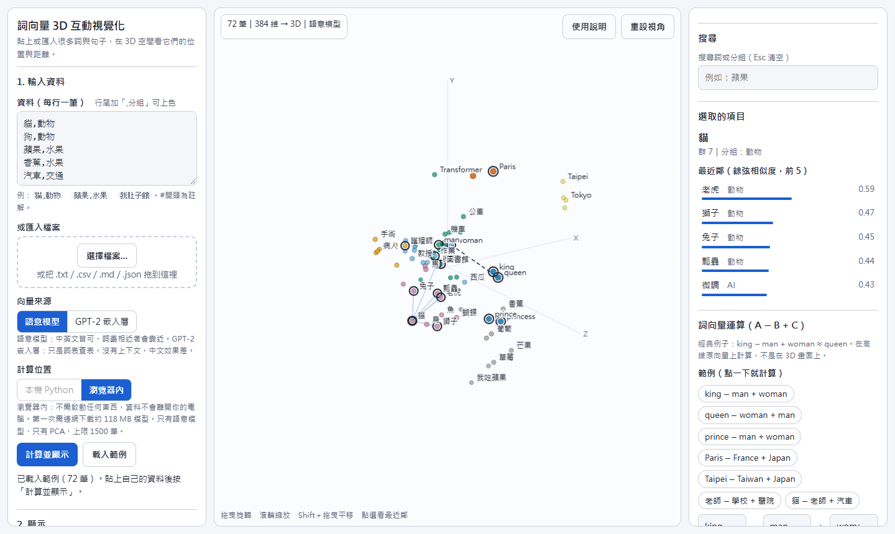

# 詞向量 3D 互動視覺化

把一堆詞或句子貼進來，在 3D 空間裡看它們「誰跟誰意思相近」，並且可以對詞向量做加減運算（例如 `king − man + woman ≈ queen`）。

**線上使用：<https://speedthunder.github.io/word-embedding-viewer/>**（打開就能用，不需要安裝）



> 圖為內建範例（72 筆中英文詞句）：選取「貓」後，畫面連出它的最近鄰（老虎、獅子、兔子…），虛線是 `king − man + woman` 的運算結果。

---

## 目錄

- [原理解說](#原理解說)
- [使用說明](#使用說明)
- [本機 GPU 版（選用）](#本機-gpu-版選用)
- [限制與注意事項](#限制與注意事項)
- [專案結構](#專案結構)

---

## 原理解說

### 1. 什麼是詞向量

電腦不懂「貓」是什麼意思，只能處理數字。**詞向量（embedding）** 就是把一個詞或一句話，轉成一長串數字（本工具是 384 個數字）。

這串數字不是隨便編的：模型讀過大量文字後，學會**把意思相近的內容轉成方向相近的向量**。所以：

- 「貓」和「老虎」的向量方向接近，「貓」和「汽車」就比較遠。
- 「距離」因此變成「語意相近程度」的代理指標。

### 2. 這個工具怎麼把文字變成向量

| 項目 | 內容 |
|---|---|
| 模型 | [`paraphrase-multilingual-MiniLM-L12-v2`](https://huggingface.co/sentence-transformers/paraphrase-multilingual-MiniLM-L12-v2)（多語言，中英文都能用） |
| 輸出維度 | 384 維 |
| 做法 | 把文字切成 token → 通過 Transformer → 對所有 token 的輸出取平均（mean pooling） |
| 單位 | 它是「句子級」模型：一個詞也被當成一個很短的句子；每筆資料實際只讀前 128 個 token |

另有一個對照用的來源：**GPT-2 輸入嵌入層**（只在本機版）。它直接取 GPT-2 的詞嵌入表（`wte`）查表，多個 token 的詞取平均。它**沒有上下文**，也幾乎只適合英文；用來和語意模型對照，很能看出「詞表查表」和「理解語意」的差別。

### 3. 為什麼要降維成 3D

384 維人眼看不到，所以要把向量**壓成 3 個座標**才能畫出來。本工具提供兩種方法：

| 方法 | 做什麼 | 優點 | 要小心 |
|---|---|---|---|
| **PCA** | 找出資料變化最大的 3 個方向，投影上去 | 保留整體結構，比例較可信，計算快 | 3 維能保留的資訊有限，會擠在一起 |
| **t-SNE** | 讓「原本近的」在 3D 裡也近，把群分得更開 | 群聚更明顯 | **遠近比例不可靠**；只適合看「誰跟誰同一群」；僅本機版、1500 筆以內 |

> **X／Y／Z 三個軸本身沒有語意**，只是降維後的方向，不能解讀成「X 代表什麼」。
> 3D 畫面只是 384 維的投影，兩個點看起來近不一定真的近，**依據是最近鄰的相似度數字**。

### 4. 餘弦相似度與最近鄰

兩個向量有多像，用**餘弦相似度**衡量（看夾角、不看長度）：

```
cos(a, b) = (a · b) / (‖a‖ × ‖b‖)      範圍 −1 ～ 1，越大越相近
```

向量先正規化成長度 1，所以內積就是餘弦相似度。每一筆資料都會預先算好**最近的 10 個鄰居**，點選一個點時顯示的就是這個。

### 5. 自動分群（k-means）

顏色可以依「自動分群」上色。做法是在**原始的 384 維向量**上跑 k-means（不是在 3D 座標上），所以分群是依真實相似度，不是依畫面上看起來的距離。

- 預設分群數 `k = round(√(n/2))`，限制在 2～12。
- 左邊的「分群數 k」滑桿（2～16）可即時重新分群。

### 6. 詞向量運算：A − B + C

經典的例子 `king − man + woman ≈ queen`：

1. `king − man`：把「男性」這個方向拿掉，剩下「王族、君主」。
2. `＋ woman`：加上「女性」這個方向。
3. 在所有資料裡找**方向最接近**這個新向量的詞（A、B、C 本身不列入答案）。

這裡的「方向」不是人寫的，是模型讀大量文字後自己學到的。運算是在 **384 維的原向量**上做，不是在 3D 畫面上。

#### 最重要的一件事：答案是不是「本來就在 C 旁邊」？

詞向量運算很容易看起來成功，其實只是答案本來就在 C 的附近。所以本工具會在結果下方多算一個數字：**這個答案原本是 C 的第幾近鄰**。

- 本來就是第 1 名 → 運算等於沒做事，**沒有加入新資訊**。
- 原本排很後面、運算後才升到第 1 → 加減**真的帶來了新資訊**。

在內建範例資料上的實測：

| A − B + C | 答案 | 答案原本是 C 的第幾近鄰 | 運算有加資訊嗎 |
|---|---|---|---|
| king − man + woman | queen（0.73） | woman 的第 5 近鄰 | 有 |
| queen − woman + man | king（0.78） | man 的第 7 近鄰 | 有 |
| prince − man + woman | princess（0.76） | woman 的第 2 近鄰 | 提升有限 |
| Paris − France + Japan | Tokyo（0.88） | Japan 的第 1 近鄰 | **沒有** |
| 老師 − 學校 + 醫院 | 病人（0.81） | 醫院的第 1 近鄰 | **沒有** |
| 貓 − 老師 + 汽車 | 轎車（0.62） | 汽車的第 1 近鄰 | **沒有**（A−B 沒意義時，結果只會退回 C 的近義詞） |

也就是說：`Paris − France + Japan → Tokyo` 看起來很漂亮，但因為 Tokyo 本來就是 Japan 最近的詞，**它並不能證明模型學到了「首都」這個方向**。

### 7. 兩種計算位置

| | 瀏覽器內 | 本機 Python |
|---|---|---|
| 怎麼算 | [Transformers.js](https://github.com/huggingface/transformers.js) 4.3.2，執行 [Xenova/paraphrase-multilingual-MiniLM-L12-v2](https://huggingface.co/Xenova/paraphrase-multilingual-MiniLM-L12-v2) 的 q8 量化版（約 118 MB，WASM） | PyTorch ＋ scikit-learn，可用 GPU |
| 何處可用 | 任何方式開啟（線上、雙擊 `index.html`） | 需啟動本機伺服器 |
| 向量來源 | 語意模型 | 語意模型、GPT-2 嵌入層 |
| 降維 | 只有 PCA | PCA、t-SNE |
| 資料筆數上限 | 1500 | 3000 |
| 需要連網 | 第一次要（下載函式庫與模型，之後瀏覽器會快取） | 第一次要（下載模型） |

兩者算出的向量非常接近：我用同一批文字比對，**餘弦相似度約 0.99–1.00**（實測 13 筆為 0.991–0.998），差異是量化造成的微小誤差。兩種模式都把每筆資料截斷在 **128 個 token**，所以長文字也不會算出不同的結果（瀏覽器版是自己做「分詞 → 模型 → 平均 → 正規化」來指定這個長度，短文字結果與函式庫官方做法完全一致）。

### 8. 資料流程

```
 你的資料（每行一筆）
        │
        ▼
   切成 token → Transformer → 平均 → 384 維向量（正規化）
        │
        ├──► 餘弦相似度 → 每筆的最近 10 個鄰居
        ├──► k-means（在 384 維上）→ 分群編號
        └──► PCA 或 t-SNE → 3D 座標
                        │
                        ▼
        Canvas 3D 畫面（旋轉、縮放、點選、搜尋）
                        │
                        └──► 向量原值留在瀏覽器 → 詞向量運算 A − B + C
```

---

## 使用說明

### 快速開始（線上）

1. 開啟 <https://speedthunder.github.io/word-embedding-viewer/>，預設載入 72 筆內建範例。
2. 滑鼠**拖曳**旋轉、**滾輪**縮放。
3. **點一個點**（例如「貓」），右邊列出它的最近鄰與相似度，畫面上連線。
4. 右上「搜尋」輸入「蘋果」，相關的點會被標出，其他變淡；按 `Esc` 清空。
5. 往下看「詞向量運算」，點一個範例按鈕。
6. 想看完整說明與實驗方法，按畫面右上的「**使用說明**」。

### 輸入你自己的資料

在左邊文字框貼上，或按「選擇檔案」／把檔案拖進來，然後按「**計算並顯示**」。

```
貓,動物
狗,動物
蘋果,水果
今天天氣很好，我們去郊遊
```

| 項目 | 規則 |
|---|---|
| 每行 | **一筆資料**（一個詞或一句話） |
| 分組（選填） | 行尾加「半形逗號＋分組」（**逗號後面不能有空格**），或用 Tab。例：`貓,動物` |
| 不會被當成分組 | 全形逗號「，」、英文句子裡的「, 」（所以一般句子不會被誤拆） |
| 略過 | 空行、`#` 開頭的行；完全相同的行會去重 |
| 長度 | 每行超過 300 字會被截斷；模型實際只讀前 128 個 token |
| 檔案 | `.txt`、`.csv`、`.md`（都當純文字）、`.json`（僅限本工具匯出的結果）；請存成 **UTF-8**，大小 4 MB 以內 |
| 不能直接用 | `.pdf`、`.docx` 等，需先轉成純文字 |
| 數量 | 瀏覽器內 1500 筆；本機版 3000 筆 |

> `.csv` 不是真正的 CSV 解析，只認「文字,分組」兩欄。

**想放論文或文章時：** 不要把 PDF 直接複製貼上（版面換行會把一句話斷成好幾行）。建議先整理成「一句話或一段一筆」，並用**章節當分組**，這樣能看出文章各部分在語意空間的分布。

### 畫面功能

**左邊面板**

| 區塊 | 功能 |
|---|---|
| 向量來源 | 語意模型／GPT-2 嵌入層（GPT-2 僅本機版） |
| 計算位置 | 本機 Python／瀏覽器內（依開啟方式自動選擇；在線上只能選「瀏覽器內」） |
| 降維方式 | PCA／t-SNE（t-SNE 僅本機版） |
| 顏色依 | 自動分群／我的分組 |
| 分群數 k、點大小、最近鄰數量 | 滑桿 |
| 顯示文字標籤、最近鄰連線、自動旋轉 | 開關 |
| 圖例／篩選 | 勾選以顯示或隱藏某個分類 |
| 匯出 | **匯出 JSON**（含向量，之後可直接拖回來載入，不必重算）、**匯出 PNG** |

**右邊面板**：搜尋、選取項目的最近鄰、詞向量運算（A − B + C，含 7 個範例按鈕）。

### 操作方式

| 位置 | 操作 | 作用 |
|---|---|---|
| 3D 畫面 | 拖曳 | 旋轉 |
| 3D 畫面 | 滾輪／雙指捏合 | 縮放 |
| 3D 畫面 | `Shift` ＋拖曳 | 平移 |
| 3D 畫面 | 點選一個點 | 顯示最近鄰與連線 |
| 3D 畫面（先 `Tab` 聚焦） | `←` `→` `↑` `↓` | 旋轉 |
| 3D 畫面 | `+` `−` `0` `Esc` | 縮放、重設視角、取消選取 |
| 切換按鈕 | `←` `→` | 切換選項 |
| 開關 | `Space` / `Enter` | 開或關 |
| 搜尋框 | `Esc` | 清空 |
| 說明視窗 | `Esc` | 關閉（焦點回到「使用說明」按鈕） |

### 詞向量運算怎麼玩

1. **先對照**：搜尋或點選 C，記下它的最近鄰；再做運算，看答案的排名怎麼變。
2. **換 C**：保持 `king − man`，把 C 換成別的詞，看結果是否跟著 C 的類別走。
3. **看排名升了多少，不要只看分數**：近義詞本來分數就高，分數高不代表運算有效。
4. **做一組沒意義的**（例如 `貓 − 老師 + 汽車`）：結果通常只是 C 的近義詞，用來分辨規律和硬湊。

### 匯出與載入

1. 計算完按「匯出 JSON」，得到 `embedding_view.json`。
2. 之後把這個檔案**拖到網頁裡**就能直接看，向量也在裡面，詞向量運算照樣能用。

> 匯出的 JSON 含有你輸入的全部原文與向量。若內容不想公開，請不要把它放進公開的地方。

---

## 本機 GPU 版（選用）

線上版已能完成大部分用途。如果你想用 **GPU 加速、GPT-2 嵌入層、t-SNE、或一次處理到 3000 筆**，可以在自己的電腦啟動本機伺服器。

**需求**：Python 與 `local/requirements.txt` 裡的套件（建議有 CUDA 版 PyTorch，沒有會自動退回 CPU）。作者的測試環境是 Python 3.12、PyTorch 2.6、transformers 4.57、scikit-learn；其他版本沒有測試過。

```bash
git clone https://github.com/speedthunder/word-embedding-viewer.git
cd word-embedding-viewer
pip install -r local/requirements.txt
python local/server.py
```

然後用瀏覽器開啟 <http://127.0.0.1:8765/>。左邊「計算位置」會自動選「本機 Python」。

- 第一次使用某個向量來源會下載模型（語意模型約 470 MB、GPT-2 約 500 MB），約 1 分鐘。
- 伺服器**只綁定 127.0.0.1**，並檢查 `Host` 與 `Origin`，只接受本機的請求。
- 一次請求上限 4 MB。
- 可用 `--port` 更改埠號。
- `local/sample_words.txt` 是內建範例資料的原始輸入（72 行），可直接貼進去試。

---

## 限制與注意事項

- **模型是小型模型**，適合看「大致的主題分布」，不適合當精確的語意判斷。最近鄰有時合理、有時不準；學術專有名詞、長段落（會被截到 128 token）的表現有限。
- **模型會學到偏見**。例如內建範例中 `woman` 最近的是「護理師」而不是 queen，這是模型從文字學到的社會關聯，不代表事實。
- **t-SNE 的遠近比例不可靠**，PCA 在 3 維能保留的資訊也有限。判斷相似度請看數字，不要只看畫面。
- **瀏覽器內計算**只有 CPU（單執行緒 WASM），比 GPU 慢；實測：300 筆約 24 秒（含第一次下載並載入模型）；模型載入後，同一頁面再算 1500 筆約 41 秒。超過 1500 筆只取前 1500 筆並提示。
- **瀏覽器內計算需要連網**：第一次要從 jsDelivr 下載 Transformers.js、從 Hugging Face 下載模型。你貼的資料**不會被送出去**，只在你的瀏覽器裡計算。
- 量化模型與本機版的向量有微小誤差（見上方一致性數字），不影響「看大致分布」，但不要拿來做精確的數值比對。
- 本倉庫目前**沒有指定授權**；使用到的模型與函式庫各有其授權，請參考各自的專案頁面。

---

## 專案結構

```
word-embedding-viewer/
├── index.html          # 整個前端（單一檔案，含 3D 繪圖、瀏覽器內計算、使用說明）
├── demo_data.js        # 內建範例資料（72 筆，含 384 維向量、PCA／t-SNE 座標、最近鄰）
├── docs/
│   └── screenshot.png  # README 畫面截圖
└── local/              # 本機 GPU 版（選用）
    ├── server.py       # 本機伺服器（只綁 127.0.0.1）
    ├── embed_core.py   # 向量、降維、分群、最近鄰的運算核心
    ├── sample_words.txt
    └── requirements.txt
```

**技術要點**：3D 繪圖是用原生 Canvas 自行做透視投影（不依賴 Three.js 等函式庫），所以單一 HTML 就能離線檢視範例與匯出的 JSON；瀏覽器內計算與降維、k-means、最近鄰都用純 JavaScript 實作。
